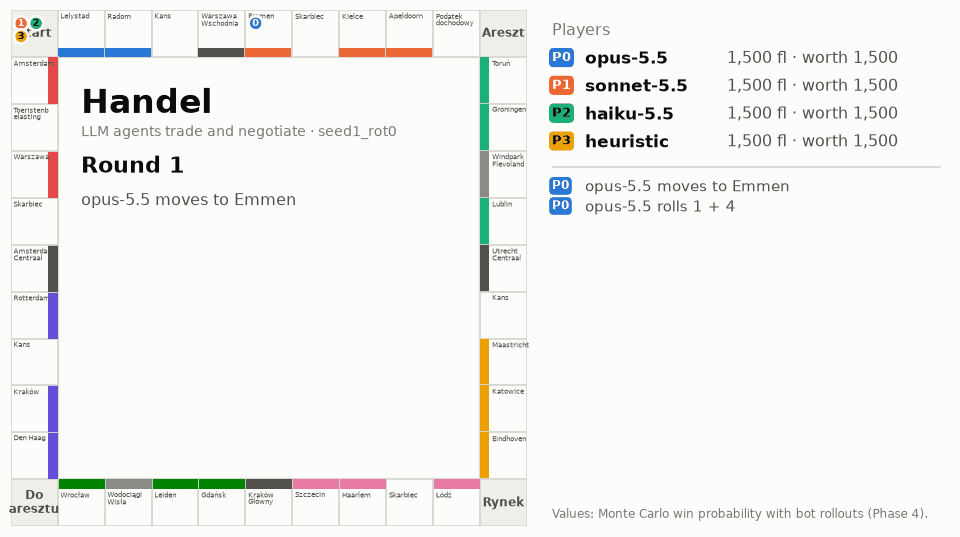

# Handel

**A benchmark where LLM agents, rule-based bots and a self-play reinforcement learning
agent play an original property-trading board game, built to measure how well they
negotiate trades.**



*Handel* means "trade" in both Polish and Dutch. The board is an original 40-space circuit
of 11 Polish and 11 Dutch cities. Prices, rents and cards are original, generated from
simple formulas (`src/handel/engine/board.py`), and the currency is the florin (fl).

## What it does

* **A deterministic game engine.** It runs 10,000 bot games in under a minute, and every
  game can be rebuilt exactly from its event log.
* **LLM players through OpenRouter.** They see the board as text and answer each decision
  in JSON. Illegal moves get one retry with the reason, and token use, cost and
  illegal-move rate are tracked per seat.
* **Real negotiation.** A trade is a proposal plus up to 3 counteroffers. Players attach
  public messages and promises, and the promises are logged but never enforced.
* **Monte Carlo fair value.** Every offer is priced by what it does to each player's
  chance of winning. Paired bot rollouts give about ±1.5 points of error, and the tool
  also gives the cash adjustment that would have made the deal fair.
* **Tournaments.** Every seed is played in every seat rotation. A crashed or interrupted
  game resumes from a prompt-hash reply cache at no extra cost, and a euro budget is
  enforced across restarts.
* **Analysis.** Win rates and head-to-head records come with confidence intervals
  bootstrapped over seeds. Trade-quality metrics ask whether each player accepted good
  offers and refused bad ones. There are charts and a notebook.
* **A replay viewer.** It's a static web page: board, chat, the models' stated reasoning
  and a win-probability chart, with offer values revealed as the game is played.

## Watch a game

```bash
python3 -m http.server 8765 --directory viewer   # then open http://localhost:8765
```

The viewer ships with two real games between Claude Opus 5.5, Sonnet 5.5, Haiku 5.5 and
the heuristic bot, and six games of the RL agent against bots. The folder has no build step, so it can also be hosted as-is, for
example on GitHub Pages.
* **Controls:** space plays and pauses, the arrow keys step, and `[` / `]` jump between
  negotiations.
* **Chart:** clicking the win-probability chart jumps to that round.

To add your own game:

```bash
uv run handel-export results/<run>/game_<seed>.json   # adds it to the viewer's menu
uv run handel-gif viewer/replays/<file>.json --out docs/demo.gif
```

## What the games show so far

Three real games on seed 1 are too few for model rankings (see Phase 6). Several
behaviours still show up clearly, and they repeat:
* **Haiku accepts set-completing swaps that complete the other side's set too.** The bot
  offered Haarlem for Eindhoven plus 140 fl in two separate games, and Haiku accepted
  both times ("Haarlem completes my Cegła set").
  - By Monte Carlo, the deal cost Haiku 42 and then 65 points of win probability.
  - In one of those games, Haiku's own counteroffer had been worth +18 to it.
* **Sonnet blocks.** It refused every offer for Kielce, the street that completes Opus's
  Polder set: 14 offers in one game and 10 in another. It refused even with almost no
  cash left, and both times it went bankrupt first. Some of the refused offers would have
  helped it.
* **Opus haggles and escalates.** It makes most of the proposals (16 in one game) and
  counters sensibly. In the tournament game it handled all 4 clearly good or bad offers
  it faced correctly.
* **The models barely use promises:** 4 in 42 negotiations, all from Opus.

**Status:** Phases 1–14 are complete. Phases 1–7 built the benchmark: engine and bots, LLM
agents, negotiation, fair value, tournaments, analysis and the replay viewer. Phases 8–14
added a self-play reinforcement learning agent and put it into the benchmark (next
section). Each phase has its own section below; the RL write-up is
[`docs/rl/RESULTS.md`](docs/rl/RESULTS.md).

## The RL agent (Phases 8–14)


A small neural network (two layers of 256, about 1.1 MB) that learned Handel by playing
against bots and against older copies of itself. PPO with action masking and the self-play
league are written from scratch in PyTorch and trained on a laptop CPU: 875 million
decisions, about 19 hours, no GPU and no API calls. Trading is learned in stages: first the
agent only buys, builds and manages its money, then it learns to answer offers, then to
propose its own trades by choosing among up to 16 generated candidate offers. It plays
through the same `Agent` interface as the bots and the LLMs, so it sits in tournaments, the
analysis and the viewer like any other seat.

| Benchmark | Result (95% CI) | Games |
|---|---|---|
| Final agent vs 3 `heuristic` bots (fair share 25%), sampling from the policy | **57.2%** [55.9%, 58.6%] | 4,000 |
| Same games, always the most likely action (how it plays in tournaments) | 57.2% [55.8%, 58.5%] | 4,000 |
| Offline tournament: RL agent vs `heuristic`, `heuristic_notrade`, `always_buy` | **64.6%** [62.3%, 66.8%] | 2,000 |
| Same tournament with a second `heuristic` bot in the RL agent's seat | 36.4% [34.5%, 38.1%] | 2,000 |
| Paired difference, RL agent minus heuristic bot in that seat | +28.3 points [+26.1, +30.5] | 2,000 |
| Two player duel against the Phase 10 agent (self-play, no own trading) | 74.0% [72.2%, 75.8%] | 2,000 |
| Showcase (paid, EUR 2.93): RL agent vs 2 Claude Haiku 5.5 seats and `heuristic` | **60.3%** [48.4%, 71.4%] | 63 |

Intervals are bootstrapped over seeds; every seed is played in every seat rotation. The
showcase is a showcase, not a ranking: the EUR 3 budget bought 63 of 80 planned games
(15 seeds in all 4 rotations, one seed in 3), so its interval is about 23 points wide.


**What it learned, and what mattered** (details and every number's source in
[`docs/rl/RESULTS.md`](docs/rl/RESULTS.md)):
* **Almost all of its edge is trading.** On the same games, its own proposals are worth
  +17 points and learned answers to offers about +5; buying, building, jail and money
  together moved only +2.4 points from Phase 10 to Phase 12.
* **It completes sets early through lopsided trades and builds at once.** Its first
  complete set comes in round 16 (the heuristic bot's in round 20), and it builds the
  next house 84–86% of the time at every level, with no "stop at 3 houses". It runs on
  less cash than the bot and mortgages about 10 times per game to build sooner.
* **The self-play league was the one idea with a large effect** (Phase 13 ablations, two
  seeds each). Without it the agent fits heuristic-type bots (+6 points against `tough`
  bots) and loses to learned players (−3 to −5 points). A small cost per refused proposal
  halves proposal spam for about 1.4 points.
* **It spams players who never say yes.** In the offline tournament it made 25 proposals
  per game (median 12, at most 147), mostly to `always_buy` and `heuristic_notrade`, which
  never accept; 1.6 per game became deals. Its deals were good for it: on the 20 games valued
  by Monte Carlo it gained +5.5 points of win probability per deal [−2.8, +14.2] (36 deals),
  and the bot that traded with it most, `heuristic_notrade`, lost 9.6 points of edge per
  deal [−30.1, −0.5].
* **Its value head knows when it is winning** (Brier score 0.130 against 0.251 for "share
  of net worth"), but it rates every position as if all opponents were as strong as
  itself, so it reads about 17 points low against heuristic bots.


**Honest limits.** Every opponent it was measured against shares the heuristic bot's
valuation model somewhere, and its bargaining is partly tuned to that model. LLM players
are the first independent test: against two Claude Haiku 5.5 seats and the heuristic bot
it won 60.3% [48.4%, 71.4%] of 63 games (Haiku 14.3% and 6.3%, the bot 19.0%), and its
138 deals gained it +9.6 points of win probability each [+7.1, +12.4], while the Haiku
seats lost 3.2 to 3.4 points per deal. Haiku countered 47% of its 412 offers instead of
refusing, so it sent 9.6 proposals per game instead of 25, and 21% became deals. Those
deal values come from rollouts played by heuristic bots, not by Haiku.
The headline is one training seed (one seed moves a run by about 1 point). Target A of
Phase 9 (beating three `always_buy` bots, where nobody trades) was never reached: 25.0%.

**In the viewer** the RL agent's "reasoning" is its three most likely options with their
probabilities and its value estimate, at every decision with a real choice. The menu has
one showcase game against Claude Haiku (`seed12_rot1`: Haiku turns down 500 fl. for
Groningen, asks 750 fl. itself, and the agent takes it: +47 points of win probability for
the agent, −74 for Haiku), two games from the offline tournament (all three with Monte
Carlo values) and four Phase 12 games against three heuristic bots.

**Commands** (`uv sync --all-groups` first; the checkpoints are in `models/`):

```bash
uv run handel-play configs/rl_vs_bots.toml --seed 1           # play it against 3 heuristic bots
uv run handel-rl-eval models/handel_rl_final.pt --opponents heuristic,heuristic,heuristic --games 4000 --rotate --seed 0
uv run handel-tournament configs/tournament_rl_offline.toml   # 2,000 games, about 2 minutes
uv run handel-analyze results/tournament_rl_offline --value --value-seeds 5   # trade quality on 20 games
uv run handel-train configs/rl/league_4p_full.toml            # train the last stage (about 9 hours)
uv run python -m handel.rl.showcase_cost configs/tournament_rl_vs_claude.toml   # cost estimate, no API calls
```

A seat in any play or tournament config can be an RL checkpoint:

```toml
[[seats]]
type = "rl"
checkpoint = "models/handel_rl_final.pt"
sample = false   # always the most likely action
```

The seat reports decisions, trades proposed and deals per game like the LLM seats report
tokens and cost (its cost is always 0). The full training curriculum, the tools and every
run are in [`configs/rl/README.md`](configs/rl/README.md), and
[`docs/rl/`](docs/rl/).

## Setup

```bash
uv sync
uv run pytest                    # 473 tests with all groups, ~2.5 min (RL tests skip without torch)
uv run pytest -m "not slow"      # skip the benchmark
uv run handel-sim --games 10000  # parallel bot simulation with a summary
uv run handel-play configs/offline_demo.toml --games 3   # LLM pipeline, offline fake models
cp .env.example .env             # then put a regular OpenRouter API key in .env
uv run handel-play configs/claude_trio.toml --seed 1     # Claude Opus/Sonnet/Haiku vs heuristic
uv run handel-value results/claude_trio/game_1.json      # fair value of every offer in a game
uv run handel-tournament configs/tournament_offline.toml # 100-game offline tournament, ~10 s
uv run handel-tournament configs/tournament_claude.toml  # 40 Claude games, ~EUR 46, resumable
uv run handel-tournament configs/tournament_cheap.toml   # Sonnet + Haiku, 40 games, ~EUR 12
uv sync --group analysis                                 # matplotlib + Jupyter for charts
uv sync --all-groups                                     # also torch + numpy for the RL agent
uv run handel-analyze results/tournament_cheap --value   # report, CIs, trade quality, charts
uv run handel-export results/tournament_claude/records/seed1_rot0.json   # game -> viewer
```

`.env` is git-ignored and read automatically when a config has a paid LLM seat (offline
configs never read it); a key there overrides one exported in the shell. OpenRouter *management* keys cannot call models (every request returns 401).
`handel-play` prints a status line every 5 rounds (`--progress N`, `0` for quiet).

## LLM agents (Phase 2)

`LLMAgent` (`src/handel/llm/agent.py`) asks the model only at real decision points:

| Decision | When | Reply |
|---|---|---|
| `buy` | landed on an affordable unowned property | `{"action": "buy" \| "decline"}` |
| `jail` | turn starts in jail with more than one option | `{"action": "pay_fine" \| "use_card" \| "roll"}` |
| `manage` | after moving, if there is something to build or unmortgage, or a color group is split between you and opponents | `{"actions": [{"type": "build", "property": "Emmen"}, ...], "trade": null \| {"to", "give", "receive", "message", "promises"}}` |
| `raise_funds` | you owe more cash than you have | `{"actions": [{"type": "mortgage", "property": "..."}, ...]}` |
| `respond` | an offer is on the table for you (a proposal or a counteroffer) | `{"action": "accept" \| "reject" \| "counter", "message": "...", "counter": null \| {"give", "receive", "promises"}}` |

* **Observation:** a static system prompt (rules + full board reference, identical for all
  seats so providers can cache it) plus a per-decision prompt: players, ownership and current
  rents by group, your own recent history, recent trades, the question, a JSON `OPTIONS:`
  line listing the legal moves, and the reply format. Properties can be named loosely
  ("Lodz", "#21", "krakow glowny").
* **Validation:** multi-action replies are replayed on a cloned state, so even-building or
  cash problems in a sequence are caught with a precise message
  (`action 2 (Build Emmen (#5)): build evenly: ...`).
* **Retry and fallback:** an invalid reply gets one retry that includes the error. If the retry
  also fails, or the API errors out, a safe default is used (decline, roll, end turn, reject,
  or a least-damaging liquidation) and the decision is marked `fallback`.
* **Metrics per seat:** decisions, LLM calls, `illegal_move_rate` (decisions whose first reply
  was malformed or illegal), fallbacks, API errors, prompt/completion/cached/reasoning tokens,
  cost in USD (from OpenRouter's `usage.cost`, or estimated from `[pricing]`) and latency.
  `handel-play` writes one JSON per game with the result, stats, every prompt/reply transcript
  and the full event log, and reports cost in USD and EUR.
* **Config:** a TOML file picks a model or bot per seat, with shared `[llm]` defaults and
  per-seat overrides (see `configs/`). Models named `fake/random` and `fake/sloppy` run
  offline for testing.
* **Prompt caching:** the system prompt (about 2,200 tokens) carries a cache breakpoint for
  `anthropic/` models (`cache_prompt`, on by default for them); the second call reads it at a
  tenth of the price. The per-seat summary shows the cached share of input tokens.
* **Cost:** about 4,000 input tokens per call, roughly one decision per round. The first live
  game (Opus 5.5, Sonnet 5.5, Haiku 5.5 and the heuristic bot, seed 1, before caching and
  before Phase 3) took 71 rounds and 10 minutes and cost $1.93: Opus $1.36, Sonnet $0.53,
  Haiku $0.04. No illegal moves and no fallbacks in 190 decisions.

## Negotiation (Phase 3)

A negotiation is a proposal followed by up to **3 counteroffers** (`GameConfig.max_counters`,
both sides together), alternating between the same two players. Whoever faces the latest
offer may accept, reject or, while counters remain, counter it; after the third counter the
only choices are accept or reject. Counters cost no turn actions, and the proposer still gets
one negotiation per turn.

* **Chat.** Every step carries a free-text `message`, and accept/reject may carry a reply
  (`AcceptTrade("Deal.")`). All messages are public: every player sees every negotiation in
  their history, the two parties step by step, everyone else as the outcome
  (`P0 ACCEPTED after 1 counteroffer: ...`, with the messages).
* **Promises.** Offers may carry up to three short `promises` ("I will not build on Polder
  for 5 rounds"). The engine never enforces them; each is logged as a `promise` event tied
  to its negotiation, so later analysis can check whether players kept their word.
* **What the LLM sees when an offer is on the table:** the whole thread so far with messages
  and promises, which offer is current, how many counters are left, and a neutral line on the
  offer's effects for both sides ("P0 would complete the Las set and could build on it";
  "you would break up your complete Kaas set"; station counts). The effects line was added
  after Haiku, in the first live game, accepted a swap that completed an opponent's set while
  calling the street it gave away "weak".
* **Records.** Each game JSON now has `negotiations` (every thread with its steps, outcome,
  closing reply and promises, rebuilt from the event log by `handel.negotiation`) and a
  `negotiation_summary` (negotiations, deals, deals after a counter, counteroffers, promises).
* **Heuristic bot.** An offer below its acceptance threshold gets a counteroffer with the same
  properties and the cash set halfway through the range both sides accept under its
  valuation model; if that range is empty there is no deal and it rejects. After a rejection
  it waits 3 rounds per consecutive rejection (up to 15) before proposing to that player again.

### Phase 3 findings (bot vs bot, 4,000 games per table)

| Table | Proposals / game (before → after) | Deals / game | Counteroffers / game | Win rates |
|---|---|---|---|---|
| heuristic vs always_buy | 26 → 6.3 | 0 | 0 | 50 / 50 |
| heuristic ×4 | 6.9 | 3.7 | 0.07 | 30 / 26 / 24 / 21 |
| heuristic, notrade, heuristic, notrade | 6.0 | 2.8 | 0.01 | trading seats 72% |

* The cooldown stops the bot spamming a player who never trades (26 offers a game before).
* Bots rarely counter each other: a bot's own proposal already splits the model surplus, so the
  partner accepts or there is no deal. Counteroffers matter against LLMs, which lowball.
  For example, 150 fl for the street that completes their set gets a 450 fl counter.
* Win rates are unchanged from Phase 1, so the earlier findings still hold.

### First live game with negotiation (Claude trio + heuristic, seed 1)

Same seats and seed as the Phase 2 game: 71 rounds, 10 minutes, **$1.24** (was $1.93; about
50% of input tokens now come from the prompt cache). 24 negotiations, 11 counteroffers,
5 deals, all 5 reached after a counteroffer; 2 promises.

* **Real haggling.** Three deals were struck by "meeting in the middle", for example Opus's
  150 fl for Radom, Haiku's counter of 230 ("Radom completes your Klei set"), Opus's 190 and
  Haiku's acceptance.
* **The effects line worked.** In Phase 2, Haiku gave away Kraków, completing Opus's Las set,
  without noticing. This time it countered "Kraków completes Las for you, so I need more" and
  got 200 fl on top of the station.
* **Blocking beats survival for Sonnet.** Opus asked Sonnet for Kielce, which completes its
  Polder set, 14 times, rising to 400 fl. Sonnet refused every offer, even with 0–20 fl in
  cash, and went bankrupt in round 34. It also noted that Opus's promise was "not binding".
  Opus escalated sensibly but never found another route.
* **Haiku made the only illegal moves:** 2 of its 83 decisions (2.4%), both times trying to
  build on Tulp without owning the whole group. Both were fixed on the retry.
* **The seed decides a lot.** The dice sequence belongs to the seed, so the game ran much as
  in Phase 2: the same bankruptcy order, and Haiku won again in round 71. Model comparisons
  need many seeds with rotated seats (Phase 5).

## Fair value of trades (Phase 4)

`handel-value <record>` replays a recorded game and prices every offer that was on the
table (proposals and counteroffers), using Monte Carlo rollouts. No API calls are needed.
It writes `<record>.value.json` and prints a table.

**Replay.** Records do not store decisions separately, but every decision leaves a
distinctive first event in the log (`buy`, `build`, `trade_countered`, ...).
`handel.replay` reads each decision back from its event, applies it, and checks that the
engine produces exactly the recorded events. A successful replay therefore proves the
rebuilt states are the real ones. Phase 2 logs, written before trade ids existed, replay
as well. Phase 7's viewer will reuse this.

**Win probability, not florins, is the currency.** From the state where an offer is on
the table, `handel.fairvalue` builds four worlds and plays each to the end 1,000 times,
with heuristic bots in every seat:

| World | What happens |
|---|---|
| no deal | the offer is rejected |
| deal | the offer is accepted |
| deal ± cash | accepted, then 200 fl move from proposer to responder, or back |

* **Paired rollouts.** Rollout *i* uses the same dice, card order and bot seeds in all
  four worlds, so the differences are measured on paired games. This removes most of the
  luck: standard errors on a change in win probability are about ±1.5 points with 1,000
  rollouts.
* **Hidden information.** The card decks are reshuffled in every rollout, because
  players cannot see their order.
* **Outputs:**
  - **dP:** each player's change in win probability (deal minus no deal), with a
    standard error.
  - **Price of cash:** win probability per 100 fl, for each side.
  - **Fair extra:** the cash adjustment (proposer → responder) that splits the deal's
    value evenly in florins. It is the midpoint between the most the proposer could add
    and still gain, and the least the responder needs to break even.
* **Uncertainty on the fair extra:** its standard error comes from a bootstrap over the
  rollouts.
* **Speed:** about 3 s per offer on 8 cores (`--rollouts`, `--workers`). The table can
  also show win probability every 5 rounds (`--timeline`).

**When there is no fair price.** The fair price is a straight-line estimate, so the tool
says when it can't give one:
* When cash is plentiful, or one side has almost no chance either way, a florin's value is
  lost in the noise. Then no price is given rather than a wild one: both sides' cash value
  must be at least 2 standard errors above zero.
* Prices more than 800 fl from the offer are far outside the ±200 fl actually measured,
  so they are marked `*` as rough.

**The answer depends on how the rest of the game is played.** All values assume every
seat plays like the heuristic bot from that point on. That includes trading, which
matters a lot:
* With trading bots, "no deal now" still allows a deal later, on bot terms.
* With bots that never trade (`--policy heuristic_notrade`), "no deal" means no deal ever.

Deal #10 below changes sign between the two policies: −42 points for Haiku with trading
bots, but +51 with non-trading bots, where completing any set is decisive. Different
rollout seeds move single values by a few points; conclusions should rest on differences
well beyond the standard errors.

### Fair value of the live game (seed 1)

`uv run handel-value results/claude_trio_phase3/game_1.json` (35 offers, 2 minutes):

| Deal | Round | Terms | dP proposer | dP responder | Cash paid → fair |
|---|---|---|---|---|---|
| #9 | 16 | Opus pays Haiku for Radom | Opus +11.9 | Haiku −5.4 | 190 → 316 fl (±25) |
| #10 | 18 | bot's Haarlem for Haiku's Eindhoven, Haiku adds cash | bot +42.4 | Haiku −42.4 | Haiku paid 140; fair is the bot paying 110 (±12) |
| #13 | 22 | Haiku's Den Haag for Opus's Groningen + cash | Haiku +1.5 | Opus −0.5 | 140 → 103 fl (±34), no clear winner |
| #19 | 31 | Opus's station + cash for Haiku's Kraków | Opus −0.2 | Haiku +6.3 | 200 → 42 fl (±151) |
| #24 | 56 | bot's Amsterdam for two Haiku streets + 180 fl | 0 | 0 | game already decided |

* **Haiku lost one counteroffer exchange badly.** In #10, both sides complete a set
  (Haiku gets Haarlem, the bot Eindhoven).
  - Haiku's own counter, a straight swap, was worth **+18 points to Haiku**.
  - The bot countered back to its first terms, Haiku adding 140 fl, and Haiku accepted.
    That was **−42 points**.
  - With both sides about to build, cash decides who builds first. Here 100 fl was
    worth about 17 points of win probability to each side, so 140 fl flipped the deal.
    That sensitivity is the bots' building race; LLM players may weigh cash differently.
* **Sonnet's blocking was right early, then wrong.**
  - Opus's first offers for Kielce (#1, 200 fl; #4, two properties + 50 fl) would have
    cost Sonnet 9.5 and 10 points. The fair cash for #1 was about 890 fl, not 200.
  - But Sonnet also refused #2 and #6 (Groningen for Kielce), which were **win-win**:
    +5.4 and +8.2 points for Sonnet, paid for by the other two players.
  - From round 11 Sonnet had under 2% to win either way, so later offers could not help
    it. They had no fair price.
* **Opus paid too little for Radom** (#9: 190 fl vs about 316 fair). Haiku's counter of
  230 was closer to fair than Opus's 150 or the 190 they settled on.
* **Win probability over time.**
  - At round 1 the seats stood at 33 / 25 / 21 / 21%. The first-player advantage shows
    in bot games too (65 of 200 wins from seat 0).
  - Haiku went 21% → 43% by round 21 → 100% by round 46.
  - Opus fell from 36% to 5% between rounds 16 and 21, after spending its cash on hotels
    on Lelystad and Radom.
* **Haiku won anyway.** It won even though the estimator says it lost 42 points in #10.
  The values assume bot play afterwards, and one game is one sample. Phase 5's many seeds,
  and Phase 6's aggregate trade metrics, will show whether such losses cost LLMs wins on
  average.

## Tournaments (Phase 5)

`handel-tournament <config>` plays many games and can be stopped and restarted at any
point. The config is a normal run config plus a `[tournament]` table:

```toml
[tournament]
seeds = 10          # seeds 1..10 (first_seed changes the start)
rotate = true       # every seed in every seat rotation (true, false, or 1..n rotations)
budget_eur = 50.0   # real-money limit across all runs of this tournament
parallel = 4        # games played at once
save_records = true # full records (transcripts, event log) in records/
```

* **Seat rotation.** The `[[seats]]` are the entrants. In rotation *r*, seat *i* holds
  entrant (*i* + *r*) mod *n*, so on each seed every entrant plays every seat on the
  same dice. The first player wins about a third of bot games (Phase 4), and a single
  seed can decide a game (Phase 3). Rotation cancels both effects within each seed.
* **Output** in `results/<name>/`:
  - `games.jsonl`: one line per finished game, with lineup, winner, net worths,
    per-seat LLM stats, negotiation counts and cost. Each line is fsynced, and a torn
    last line from a crash is dropped on the next read.
  - `records/<game_id>.json`: the full record, readable by `handel-value` and the
    replay viewer.
  - `errors.jsonl`: games that raised an error. They are retried on the next run.
  - `tournament.json`: the config and a hash of its `game`, `llm` and `seats`
    sections. A changed config is refused in an existing directory unless you pass
    `--force`. Seeds, budget and parallelism may change freely, so a tournament can be
    extended with `--seeds 20`.
* **Resume.** Re-running the same command skips finished games. A game cut off mid-way
  is not lost:
  - Prompts depend only on the game state and the engine is deterministic, so a replayed
    seed sends exactly the same requests in the same order.
  - Every reply is stored in `cache.sqlite` under a hash of (model, messages, request
    parameters), written after each call.
  - The replayed game is therefore answered from the cache, for free, up to where it
    stopped, and continues with new calls from there. A test kills a game after 15
    calls and resumes it: the result is identical to an uninterrupted run, and no call
    is paid twice.
* **Budget.** The same SQLite file keeps a ledger of every paid call, so the euro limit
  holds across restarts:
  - Before each paid call, the client refuses once the limit is reached. The game then
    stops, unrecorded, and later resumes from the cache.
  - Before starting a game, the runner checks that the remaining budget covers the
    average paid cost of a game, times the number of games running.
  - Cached replies cost nothing new.
  - Overshoot is at most one call per running game.
  - Raise `budget_eur` (or pass `--budget-eur`) and re-run to continue.
* **Rate limits.** With several games running at once, the provider sometimes answers
  429 ("too many requests"). The tournament client waits these out: up to 8 retries,
  respecting the server's `Retry-After` header.
  - **The problem:** a game that kept failing used to let the LLM seat play the safe
    default (decline, end turn, reject). That measured the API instead of the model. In
    the first 4-game cheap run it affected 13% of Sonnet's decisions.
  - **What happens now:** the game aborts instead. It goes to `errors.jsonl` and is
    replayed from the cache on the next run.
  - **Older games:** the standings warn about games that still contain such fallbacks,
    and `--redo-api-errors` plays them again.
* **Ctrl-C** lets running games finish their current call, then stops. A fatal API
  error (bad key, no credits) stops the whole run instead of being counted as a failed
  game.
* **Costs are recorded two ways.** `cost_usd` is a game's full cost, including replies
  replayed from the cache, so games are comparable. `fresh_cost_usd` is what that run
  actually paid.
* **Standings.** At the end, and with `--summary` at any time, the runner prints:
  - games, wins and win rate per entrant;
  - average net worth;
  - the illegal-move rate and fallbacks;
  - cost;
  - wins by seat.

  These are raw counts; confidence intervals come in Phase 6.

Offline example (`configs/tournament_offline.toml`, 25 seeds × 4 rotations = 100 games in
about 9 s with 4 games in parallel):

```
  entrant                games  wins win rate avg net worth illegal fallbacks      cost  wins by seat
  heuristic                100    75    75.0%         11428       -         0 $    0.00  20/25 19/25 17/25 19/25
  always_buy               100    24    24.0%          4063       -         0 $    0.00  6/25 5/25 5/25 8/25
  fake/sloppy              100     1     1.0%           821   22.4%       463 $    0.00  1/25 0/25 0/25 0/25
  fake/random              100     0     0.0%           647    0.4%         5 $    0.00  0/25 0/25 0/25 0/25
```

`configs/tournament_claude.toml` sets up the real benchmark:
* Entrants: Opus, Sonnet and Haiku 5.5 plus the heuristic bot.
* 10 seeds × 4 rotations = 40 games.
* Expected cost about $50 (EUR 46), going by the $1.24 seed-1 game; the budget is
  capped at EUR 50.
* With `parallel = 4`, roughly 2 hours.

## Analysis (Phase 6)

`handel-analyze <tournament dir>` writes `analysis/report.md`, `analysis/summary.json` and
four charts. With `--value`, it first runs the Phase 4 fair-value estimator on every game
that has no value report yet. That step is free, takes a few minutes per LLM game at the
default 300 rollouts, and is skipped on later runs. `notebooks/analysis.ipynb` walks
through the same material, with the worst accepted offers and the chat that led to each.

**Outcomes, with honest intervals.**
* **Win rate, average placement and head-to-head:**
  - Placement runs from 1st to 4th. Survivors rank by net worth; the bankrupt rank in
    reverse order of going out.
  - Head-to-head is the share of shared games in which A finished above B.
  - Placement uses every position, not just first, so it says more per game than the win
    rate does.
* **Bootstrapped over seeds.** The four rotations of a seed share their dice, so they are
  not independent games. Intervals resample whole seeds (2,000 resamples) once there are at
  least 5 seeds.
* **Wilson as a fallback.** With fewer seeds, the report falls back to a Wilson interval
  that treats games as independent, marked `w`. That interval is too narrow, and the report
  says so above every small tournament.
* **Wins by seat** checks that rotation cancelled the first-player advantage.

**Negotiation behaviour** (from the records):
* proposals per game, and the share of proposals that became deals;
* how each entrant answered the offers it faced: accepted, countered or rejected;
* deals and promises.

**Trade quality** (from the fair-value reports). For the player answering an offer, the
offer is:
* **good** if accepting raised its win probability by more than 2 standard errors;
* **bad** if accepting lowered it by more than 2 standard errors;
* **unclear** otherwise.

Per entrant, the report gives:
* **Decision accuracy:** the share of clear offers handled correctly (good accepted, bad
  declined).
* **Win probability gained per deal**, and the **edge over the partner** per deal.
* **Price vs fair:** the florins gained relative to the fair price.

As in Phase 4, these values assume bot play for the rest of the game.

**Charts** (matplotlib, PNG). Each entrant keeps one colour across every chart, from a
palette checked for colour-blind safety. Every mark is also labelled, so colour is never
the only cue.
* `win_rates.png`: win rate with its interval and the fair-share line.
* `head_to_head.png`: a red–grey–blue matrix.
* `offers.png`: every offer an entrant answered, placed at its value to them. Filled
  markers were accepted, hollow ones declined; good play is filled on the right of zero
  and hollow on the left.
* `timeline.png`: win probability through one game, with its deals marked.

**How much data is enough.** The report ends with a table:

| 95% margin | games per entrant (25% win rate) | games for a 50/50 head-to-head |
|---|---|---|
| ±15 points | 33 | 43 |
| ±10 points | 73 | 97 |
| ±5 points | 289 | 385 |

These assume independent games, so the real need is a bit higher.
* A 40-game tournament separates only large differences in win rate.
* Trade quality accumulates faster: one LLM game has 20–35 offers on the table.

### Choosing what to run

| Config | Entrants | Games | Approx. cost |
|---|---|---|---|
| `tournament_offline.toml` | fake models + bots | 100 | free |
| `tournament_cheap.toml` | Sonnet, Haiku, 2 heuristic bots | 40 | ~$13 / EUR 12 (budget EUR 15) |
| `tournament_claude.toml` | Opus, Sonnet, Haiku, heuristic | 40 | ~$50 / EUR 46 (budget EUR 50) |

Opus was about 70% of the cost of a three-Claude game. That is why the cheap config leaves
it out: the table still holds two LLMs, so LLM-vs-LLM negotiation stays. To try one seed
(four games) first: `--max-games 4`.

### What the data shows so far

* **Offline tournament (100 games, 25 seeds):**
  - The heuristic bot wins 75% [67, 83], always-buy 24% [17, 31].
  - The fake models win 0–1%.
  - Seats 0–3 win 22–27% each, so rotation removes the seat effect.
  - Of 787 offers valued, always-buy rejected all 566 it faced, including 46 good ones.
    That shows the accuracy metric does what it should.
* **Claude tournament (1 game, seed 1 rotation 0):** too little data for conclusions, and
  the report says so. Still, one pattern repeats:
  - The heuristic bot offered Haiku the same swap as in the Phase 3 game: Haarlem for
    Eindhoven plus 140 fl.
  - Haiku accepted again, saying "Haarlem completes my Cegła set". It valued completing
    its own set and missed that the swap also completed the bot's set.
  - It was the worst deal of the game: −65 points for Haiku, +62 for the bot. In Phase 3
    it was −42.
  - Opus answered correctly every clear offer it faced (4 of 4).
  - Sonnet again refused every offer for Kielce, 10 in all.

## Replay viewer and demo (Phase 7)

* **`handel-export <record>`** replays the record through the engine, so every frame is a
  verified state.
  - It writes one frame per decision: board, cash, positions and readable event lines.
  - It also attaches the negotiation threads, with messages, promises and, when a
    `.value.json` sits next to the record, each offer's Monte Carlo value.
  - It attaches the LLMs' stated reasoning (for an RL seat: its top options and value
    estimate, Phase 14), and adds the replay to `viewer/replays/index.json`.
* **`viewer/`** is a static page with no dependencies and no build step:
  - the board, with original colour bands, numbered owner badges, buildings and tokens;
  - player cards;
  - a win-probability chart with hover and click-to-jump;
  - tabs for negotiations, reasoning and events.
* **No spoilers.** Offers, values and reasoning appear only once play reaches them.
* **Layout.** It works in light and dark mode and at phone width, where cell names give
  way to the badges and the narration.
* **Original look.** The street-group colours are an original, colour-blind-checked
  palette. They are deliberately not the colour sequence of any published board, and
  players are identified by labelled "P#" badges, never colour alone.
* **Reworded model text.** The models use a brand-like word for a complete colour set. In
  model-written text the export shows it as "full set" and says how many uses were
  changed; `--keep-wording` turns this off.
* **`handel-gif <replay>`** renders the README animation with matplotlib. Frames are
  sampled through the game, and every step of a deal is held long enough to read.

## Engine design

```
src/handel/
  engine/
    board.py    static board: spaces, groups, prices, rent ladders
    cards.py    Kans ("chance") and Skarbiec ("treasury") decks, as data
    actions.py  immutable action types + TradeOffer
    state.py    GameState / PlayerState / GameConfig, Phase and Stage enums
    rules.py    new_game, legal_actions, validate, apply (all rule logic)
  bots/         RandomBot, AlwaysBuyBot, HeuristicBot, shared default policies
  llm/          observation + prompts, reply parsing, OpenRouter and fake clients, LLMAgent,
                prompt-hash reply cache and spend ledger (cache.py)
  config.py     TOML seat config -> agents
  negotiation.py  rebuild negotiation threads (chat log, promises) from an event log
  replay.py     rebuild every state of a recorded game from its event log (verified)
  fairvalue.py  Monte Carlo trade values + handel-value CLI
  tournament.py seeds x seat rotations, JSONL results, resume, budget + handel-tournament CLI
  analysis.py   CIs (seed bootstrap, Wilson), placements, head-to-head, negotiation and
                trade-quality metrics, report + handel-analyze CLI
  charts.py     matplotlib charts for the report and notebook
  export.py     record -> replay JSON for the web viewer + handel-export CLI
  gif.py        replay -> animated GIF + handel-gif CLI
  rl/           the RL agent (Phases 8-14): observation, actions, policy, PPO, league,
                trade modes and candidates, evaluation and analysis tools, RL seats (seat.py)
viewer/         static replay viewer (index.html, app.js, style.css, replays/)
notebooks/      analysis.ipynb
  runner.py     play_game (agent loop), continue_game (rollouts), simulate_many
  play.py       handel-play CLI: play configured games, save records
```

* **State machine.** `apply(state, action)` performs one decision, then runs the
  automatic flow (dice, movement, rent, cards, debt settlement, turn order) until the
  next real decision. `state.phase` says what kind of decision is pending
  (`JAIL`, `BUY`, `MANAGE`, `RAISE_FUNDS`, `TRADE_RESPONSE`) and
  `state.decision_player` says who must make it.
* **Deterministic.** The dice RNG lives in the state, so a seed fully determines a
  game for deterministic agents. `state.clone()` snapshots everything, including
  the RNG; Monte Carlo rollouts clone a state and give it a fresh RNG.
* **Single source of truth for legality.** `validate(state, player, action)`
  returns `None` or a human-readable reason (later fed back to LLMs on illegal moves).
  `legal_actions` enumerates exactly the actions that validate; a property test
  checks the two agree on every position at many random game states.
* **In-place mutation for speed.** `apply` mutates; `step` is a copy-on-write wrapper.
* **Parametric trades.** `ProposeTrade(TradeOffer(...))` and `CounterTrade(TradeOffer(...))`
  can't be enumerated; they are legal (in `MANAGE` and `TRADE_RESPONSE` respectively)
  whenever `validate` accepts the specific offer. `state.thread` holds the current
  negotiation and `state.trade_id` numbers negotiations; every logged step carries the id.

## Rules implemented

Buying; rent (doubled on unimproved complete sets); stations (rent by count) and
utilities (dice multiplier); houses and hotels with even building and selling and a
finite supply (32 houses, 12 hotels); mortgages (50% value, 10% interest to lift,
10% interest when a mortgaged property changes hands); jail (Go-to-jail space,
cards, three doubles; pay the fine, use a card, or roll for doubles, with a forced
fine after the third failed roll); 32 cards; income and tourist taxes; debts with a
raise-funds phase (sell buildings, mortgage); bankruptcy to a player (they get
everything) or to the bank (properties return unowned); trades of properties and
cash; a turn cap (default 150 rounds) after which the highest net worth wins.

### Deliberate simplifications

* **No auctions yet.** A declined or unaffordable property stays with the bank.
  `GameConfig.auctions` and a reserved `Phase` slot keep room for them.
* Building, mortgaging and trading happen once per turn, after moving (`MANAGE`),
  not during the buy or jail decision.
* Cash in a trade flows in one direction only; at most one negotiation per turn, opened by the
  player whose turn it is. Promises are free text and never enforced.
* If a player goes bankrupt while owing several creditors (e.g. "pay every
  player"), the first unpaid creditor receives the assets.
* Breaking a hotel during a housing shortage drops the street to as many houses
  as the bank has, which can leave a group uneven.
* Net worth (for the turn cap) = cash + property price (minus the payoff if
  mortgaged) + buildings at cost.

## Bots

| Bot | Behaviour |
|---|---|
| `random` | Uniform over legal actions; ends turn with p = 0.5 when managing; never proposes trades. |
| `always_buy` | Buys whatever it can afford, builds whenever possible, never trades. |
| `heuristic` | Keeps a cash buffer that grows with opponents' rent threat; buys when affordable or when it completes or blocks a set; builds where rent gain per florin is highest; leaves jail early and stays late; liquidates the least valuable assets first; proposes set-completing swaps or cash purchases, judged by a valuation model that rewards completed sets and penalises handing an opponent one; counters offers that fall short when a mutually acceptable price exists; backs off from players who keep rejecting it. |
| `heuristic_notrade` | Same, but never proposes or counters (it still accepts or rejects offers). |

## Phase 1 findings (bot vs bot)

| Table (10,000 games, 8 workers) | Time | Avg rounds | Ends in bankruptcy |
|---|---|---|---|
| heuristic ×2, always_buy, random | 18 s | 87 | 84% |
| heuristic ×4 | 15 s | 71 | 97% |
| heuristic_notrade ×4 | 17 s | 128 | 29% |
| always_buy ×4 | 8 s | 129 | 26% |

* **Trading is what makes games decisive.** Without trades, complete sets only form
  through dice luck and most games hit the turn cap.
* **Heads-up against a partner who never trades, careful play gains little**:
  heuristic vs always_buy is about 48/52. Proposing trades is what wins: at a table
  of two trading and two non-trading heuristics, the trading seats win ~72%.
  This supports the benchmark's premise that negotiation is the key skill.
* **Seat 0 has an edge** (~29% vs 25% expected at a 4-heuristic table). Tournaments
  will rotate seats so this cancels out.
