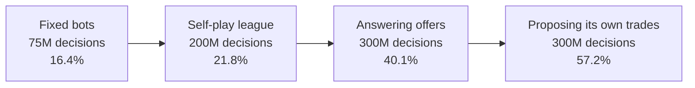
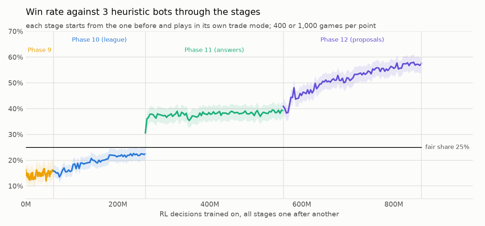
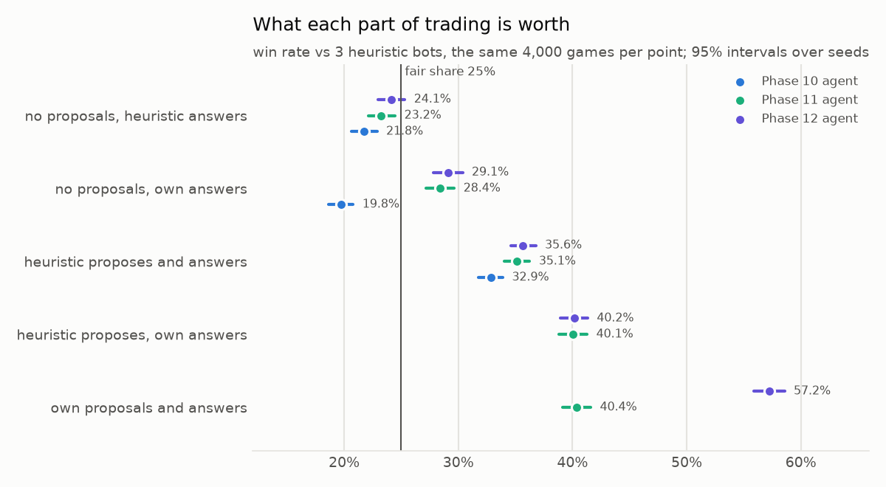
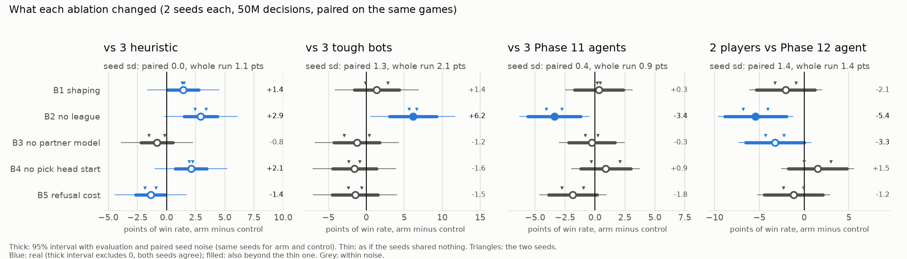

# Handel

**LLM agents, hand-written bots and a self-play reinforcement learning agent, all playing the same
original property-trading board game, to measure who negotiates best.**


*Handel* means "trade" in both Polish and Dutch. The board is an original 40-space circuit of
11 Polish and 11 Dutch cities, with its own prices, rents and cards, and the currency is the
florin (fl). Players buy, build, go to jail, mortgage, and above all **trade with each other**:
a trade is a proposal plus up to three counteroffers, with public chat messages and promises
that are never enforced.

## Results at a glance

| Matchup (4 players, fair share 25%) | Win rate, 95% CI | Games |
|---|---|---|
| **RL agent** vs 3 heuristic bots | **57.2%** [55.9, 58.6] | 4,000 |
| Same, on 4,000 fresh games never used before | 56.2% [54.9, 57.6] | 4,000 |
| **RL agent** vs heuristic, heuristic without trading, always-buy | **64.6%** [62.3, 66.8] | 2,000 |
| **RL agent** vs 2 Claude Haiku 5.5 agents and a heuristic bot | **60.3%** [48.4, 71.4] | 63 |

Every seed is played in every seat rotation, and intervals are bootstrapped over seeds. The Claude
match is a small paid showcase (EUR 2.93), so its interval is wide. In it, Haiku won 14.3% and
6.3%, and the heuristic bot 19.0%.

The RL agent is a 1.2 MB network trained on a laptop CPU in about 19 hours, with no GPU and no API
calls. Almost all of its edge comes from trading: learning to propose its own deals is worth
**+17 points** of win rate on its own.

## What's inside

* **A fast, deterministic game engine.** 10,000 bot games in under a minute, and every game can be
  rebuilt exactly from its event log. A property test checks that the legal-move generator and
  the validator agree on every position.
* **LLM players over OpenRouter.** They read the board as text and answer each decision in JSON.
  Illegal moves get one retry with the reason; tokens, cost and illegal-move rate are tracked
  per seat, and prompt caching cut the cost of a game by about a third.
* **Real negotiation.** Proposals, counteroffers, free-text messages and promises, all logged as
  threads.
* **Monte Carlo fair value.** Every offer is priced by what it does to each player's chance of
  winning, using paired rollouts (same dice in every world) for about ±1.5 points of error, plus
  the cash adjustment that would have made the deal fair.
* **Tournaments that survive crashes and protect your wallet.** Seat rotation, a prompt-hash reply
  cache (an interrupted game replays for free), and a hard euro budget that holds across restarts.
* **Statistics done properly.** Win rates and head-to-head records with confidence intervals
  bootstrapped over seeds, and trade-quality metrics: did a player accept the good offers and
  refuse the bad ones?
* **A self-play RL agent.** PPO, action masking and a league of past versions, written from scratch
  in PyTorch, that plugs into the same agent interface as the bots and the LLMs.
* **A replay viewer.** A static web page with the board, the chat, each player's reasoning and a
  win-probability chart, with no spoilers.

## The RL agent


**How it sees and acts.** Each decision, the game state becomes 669 numbers from the agent's point
of view (seats rotated so it is always "player 0"). The network picks from 125 possible actions
(buy, build on square X, mortgage square Y, accept, reject...) with every illegal one masked out.
For trades, a candidate generator builds up to 16 sensible offers (set-completing swaps, cash
deals, counteroffers), and a small scorer inside the network picks one or "no trade".

**How it was trained.** Trading is the hardest thing to learn, so the agent learned it in stages,
each starting from the one before:



*Win rates against 3 heuristic bots after each stage.* In the self-play league the other seats are
filled by the current policy, older snapshots of itself and a pool of bots, with Elo ratings to
track progress and a fixed benchmark as a guard rail, so the agent can't just get good at beating
itself.



**Where the gain came from.** The same weights, played in different trade modes on the same games:
learned answers to offers are worth about +5 points, making proposals at all about +12, and
choosing its own proposals instead of the heuristic bot's another +17. Everything outside trading
(buying, building, jail, money) moved only +2.4 points.



**What it learned.** Compared with the heuristic bot in the same seat:
* It completes colour sets early through lopsided trades (first full set in round 16, the bot in
  round 20) and builds at once, 84 to 86% of the time at every level. No "stop at 3 houses".
* It runs on less cash and mortgages about 10 times a game to build sooner.
* Its value head knows when it is winning (Brier score 0.130 against 0.251 for the obvious guess).

**What mattered (ablations).** 12 extra training runs, each idea tested with 2 random seeds against
a control on the same games:

| Idea | Effect | Verdict |
|---|---|---|
| Self-play league | Without it: better against heuristic bots, but **−3 to −5 points against learned players** and twice the proposal spam | **Essential** |
| Heuristic bot's offer as a starting hint | Slightly better without it | Not needed |
| Reading the heuristic bot's valuation of the partner | About level without it | Not needed |
| Reward shaping on net worth | +1.4 points | Small |
| Small cost for every refused proposal | Halves proposal spam for about 1.4 points | Worth it against paid LLM players |



The full write-up, with every number, chart and limitation, is in
[`docs/rl/RESULTS.md`](docs/rl/RESULTS.md).

## What the LLMs do at the table

Some behaviours repeat across games:
* **Haiku accepts swaps that complete the other side's set too.** The bot offered Haarlem for
  Eindhoven plus 140 fl in two separate games, and Haiku accepted both times ("Haarlem completes
  my Cegła set"). By Monte Carlo, that deal cost it 42 and then 65 points of win probability.
* **Sonnet blocks, even when it hurts.** It refused every offer for Kielce, the street that
  completes Opus's set, 14 times in one game, even with almost no cash left, and went bankrupt
  first. Some of those offers would have helped it.
* **Opus haggles.** It makes most of the proposals, counters sensibly, and in the tournament game
  handled all 4 clearly good or bad offers it faced correctly.
* **Promises are rare:** 4 in 42 negotiations, all from Opus.
* **Against the RL agent,** Haiku countered 47% of its offers instead of refusing, and lost 3.2 to
  3.4 points of win probability per deal it made with it.

## Honest limitations

* The bots, the candidate offers and the fair-value judge all share the heuristic bot's valuation
  model, so the agent's bargaining is partly tuned to it. The Claude showcase is the first
  independent test, and it's only 63 games.
* The headline numbers come from one training seed per stage; one seed moves a run by about
  1 point.
* Where the answer is usually no, the agent proposes too often. A refusal costs nothing in the
  game, but against LLM players every proposal is a paid API call.

## Quick start

Needs Python 3.12 and [uv](https://docs.astral.sh/uv/).

```bash
uv sync --all-groups                 # everything, including torch for the RL agent
uv run pytest -m "not slow"          # fast tests (all of them: uv run pytest)

# watch recorded games in the browser
python3 -m http.server 8765 --directory viewer      # then open http://localhost:8765

# the RL agent
uv run handel-play configs/rl_vs_bots.toml --seed 1               # play it against 3 heuristic bots
uv run handel-rl-eval models/handel_rl_final.pt --opponents heuristic,heuristic,heuristic --games 4000 --rotate --seed 0
uv run handel-tournament configs/tournament_rl_offline.toml       # 2,000 games, about 2 minutes
uv run handel-train configs/rl/league_4p_full.toml                # train the last stage (about 9 hours)

# bots and offline LLM stand-ins, no API key needed
uv run handel-sim --games 10000
uv run handel-tournament configs/tournament_offline.toml

# real LLM players (costs money; every tournament config has a euro budget)
cp .env.example .env                 # add your OpenRouter API key
uv run handel-play configs/claude_trio.toml --seed 1
uv run handel-value results/claude_trio/game_1.json   # fair value of every offer in that game
```

Any seat in a play or tournament config can be a bot, an LLM or an RL checkpoint:

```toml
[[seats]]
type = "rl"
checkpoint = "models/handel_rl_final.pt"
sample = false   # always the most likely action
```

## Repository layout

```
src/handel/
  engine/       board, cards, actions, game state and all rule logic
  bots/         random, always-buy and heuristic bots
  llm/          prompts, reply parsing, OpenRouter client, LLM agent, reply cache and spend ledger
  rl/           observation, action masks, policy network, PPO, league, trade candidates,
                evaluation and analysis tools, RL seats for tournaments
  runner.py     game loop and parallel simulation
  tournament.py seat rotation, resume, budget
  analysis.py   confidence intervals, head-to-head, trade quality
  fairvalue.py  Monte Carlo trade values
  export.py     game record to replay for the viewer
configs/        play and tournament configs; configs/rl/ for training
models/         trained RL checkpoints
viewer/         static replay viewer and recorded games
notebooks/      analysis notebooks that rebuild the charts
docs/           RL results write-up, benchmark details, charts
tests/          470+ tests
```

## Build history

The project was built in 14 milestones, one per commit series:

| Phase | Milestone |
|---|---|
| 1 | Deterministic game engine, rule-based bots and tests |
| 2 | LLM agents over OpenRouter |
| 3 | Negotiation: counteroffers, messages and promises |
| 4 | Monte Carlo fair value of trades |
| 5 | Resumable tournaments with a reply cache and a euro budget |
| 6 | Analysis with confidence intervals and trade quality |
| 7 | Web replay viewer and demo GIF |
| 8 | RL foundations: observation encoder, masked action space, rollouts, evaluation |
| 9 | PPO from scratch, first training against fixed bots |
| 10 | Self-play league with snapshots, Elo ratings and guard rails |
| 11 | Learning to answer trade offers |
| 12 | Learning to propose trades: candidate generator and scorer |
| 13 | Ablations, strategy analysis and value calibration |
| 14 | RL agent in tournaments and the viewer; showcase against Claude Haiku |

More detail on the engine, the LLM agents, fair value, tournaments and the viewer is in
[`docs/BENCHMARK.md`](docs/BENCHMARK.md); the training configs are explained in
[`configs/rl/README.md`](configs/rl/README.md).
