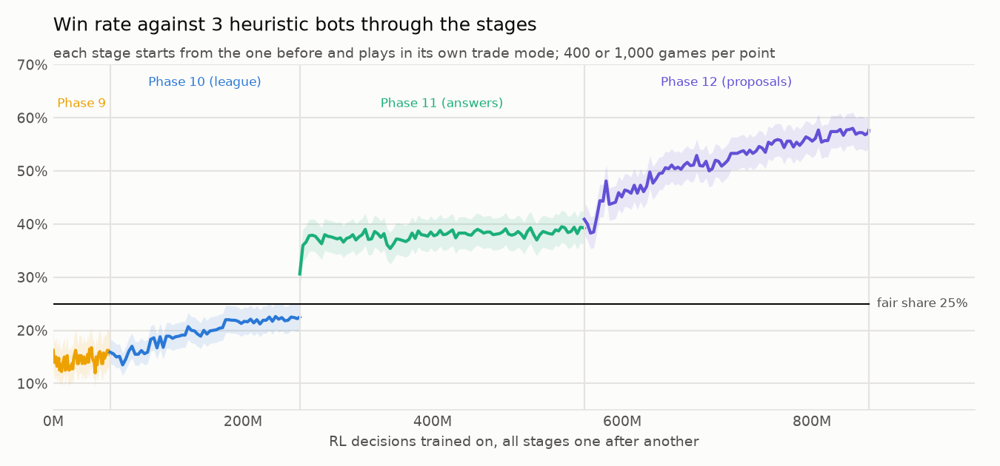
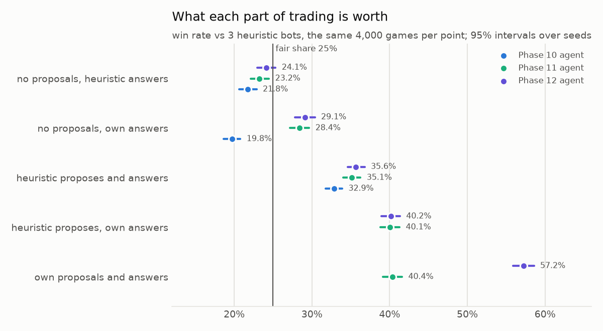
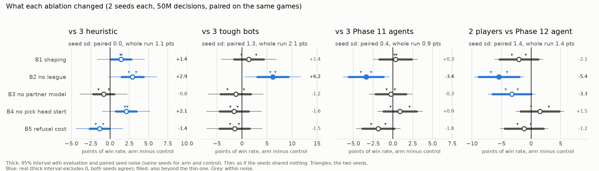
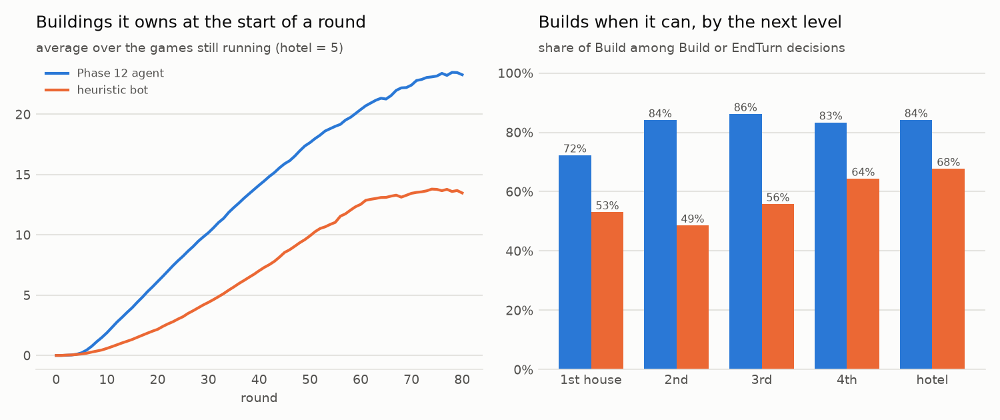
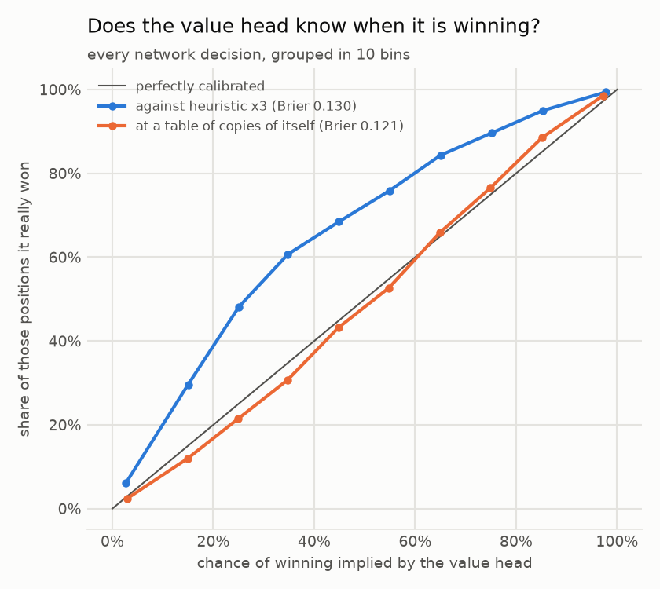

# Handel RL: results

A self-play reinforcement learning agent for Handel, the original property-trading board game
in this repository. Written Nov 20, 2026. Every chart can be rebuilt with `notebooks/rl_analysis.ipynb`.

## Setup

* **Game:** 4 players, 22 cities, buying, building, jail, mortgages and free-form trades between
  players. A game ends when one player is left or after 150 rounds.
* **Agent:** an MLP over 669 inputs (two layers of 256) with a masked policy head over 125 actions, a
  value head, and from Phase 12 a small *candidate scorer* that picks among up to 16 trade offers
  built by a candidate generator (or "no trade"). About 1.2 MB.
* **Training:** PPO written from scratch, win/loss reward (+1 / -1/3), on an 8-core laptop CPU, no
  GPU. Four stages, each starting from the one before: fixed bots (Phase 9, about 75M decisions), a
  self-play league with past snapshots and a bot pool (Phase 10, 200M), answering trade offers
  (Phase 11, 300M), proposing its own trades (Phase 12, 300M). About 19 hours of training in all.
* **Benchmark:** win rate against 3 copies of the hand-written `heuristic` bot (a fair share is
  25%), on the same 4,000 games for every agent (1,000 seeds, every seat), with 95% bootstrap
  intervals over seeds. No game used for evaluation was ever a training game.

## Main results

| Agent (trade mode) | Win rate vs 3 `heuristic` | Games |
|---|---|---|
| Untrained network | 0.0% (Wilson upper bound 0.2%) | 2,000 |
| `heuristic` bot without trading, same seat | 16.3% [15.0%, 17.6%] | 2,000 |
| Phase 9: fixed bots only, no trading | 16.4% [15.0%, 18.0%] | 2,000 |
| Phase 10: self-play league, no own trading | 21.8% [20.6%, 22.9%] | 4,000 |
| Phase 11: learned answers, the heuristic bot proposes for it | 40.1% [38.8%, 41.3%] | 4,000 |
| **Phase 12: learned answers and own proposals** | **57.2% [55.9%, 58.6%]** | 4,000 |
| Phase 12 agent on 4,000 fresh games (`--seed 100000`) | 56.2% [54.9%, 57.6%] | 4,000 |

The Phase 12 agent also wins 67.5% against 3 `lowball` bots (lowball offers), 61.6% against 3
`tough` bots (four times the heuristic bot's acceptance margin), and in two player games 74.0%
[72.2%, 75.8%] against the Phase 10 agent and 65.0% [63.1%, 66.8%] against the Phase 11 agent
(2,000 games each).

**Where the gain came from** (the same weights in different trade modes, same games, so training
time is not part of the difference): learned answers to offers are worth about +5 points, making
proposals at all about +12, choosing its own proposals instead of the heuristic bot's +17 more.
Everything outside trading (buying, building, jail, money) moved only +2.4 points from Phase 10
to Phase 12.

## What helped and what did not (ablations)

Each ablation is the Phase 12 setup cut to 50M decisions, from the Phase 11 agent, with one change,
trained with **2 seeds**, and compared with the control of the same seed on the same games. The
control reaches 48.2% after 50M decisions. "Real" means the interval (with evaluation and
training seed noise) excludes 0 and both seeds agree; "robust" means it would hold even if the two
seeds of arm and control shared nothing.

| Idea tested | vs 3 heuristic | vs learned agents (Phase 11 table / 2p duel vs Phase 12) | Proposals | Verdict |
|---|---|---|---|---|
| Self-play league (B2: train against bots only) | +2.9 without it (real) | **-3.4 / -5.4 without it (robust)** | x2.2 at a self-play table (robust) | **Needed.** Without it the agent fits heuristic-type bots (+6.2 against `tough`) and loses to learned players |
| Head start: the heuristic bot's offer as a prior (B4: no prior) | +2.1 without it (real) | level | x1.4 (robust) | **Not needed** (the plan predicted the opposite) |
| Partner-model features: the heuristic model's view of the partner (B3: hidden) | -0.8 (level) | level / -3.3 (real, not robust) | level | **Not needed** for the benchmark gain |
| Net worth reward shaping (B1) | +1.4 (real) | level | level | Small; not needed |
| Cost of -0.01 per refused proposal (B5) | -1.4 (real) | level | **x0.47 vs bots, x0.36 at a self-play table (robust)** | **Works:** cuts proposal spam by half or more for about 1.4 points |

In every arm the difference is in the agent's own proposals: with the heuristic bot proposing for
it, all arms are level with the control.

**Seed noise is large.** Two runs with the same config and different seeds end 1.9 points apart
on the benchmark (49.1% vs 47.2%, on the same games, beyond what evaluation luck explains); one
training seed moves a run by a standard deviation of about 1.1 points (2.1 against `tough`). So a
single run per idea, as in Phases 9 to 12, cannot separate effects smaller than about 3 points.
The ablations above can, only because arm and control share their seeds and games.

## What strategy it learned

Compared with the heuristic bot in the same seat on the same 4,000 games:

* **Buys almost everything** (98% of affordable squares, the bot 92%), and keeps buying late in
  the game where the bot's cash reserve makes it skip a third.
* **Completes sets early through lopsided trades** (first complete set in round 16, the bot in
  round 20; 2.5 squares in and 1.4 out per game) and **builds at once**: 84% to 86% of the time
  at every level from the 2nd house to the hotel. There is no "stop at 3 houses".
* **Runs on lower cash in the middle game** (median 443 fl. in rounds 10 to 19, the bot 549) and
  mortgages about 10 times per game by choice to build sooner.
* **Leaves jail early and mostly stays in late,** like the bot, but still pays 13% of the time
  late in the game where staying in is free.

**The value head knows when it is winning** (Brier score 0.130, against 0.251 for the obvious
guess "share of all net worth") and is calibrated at a table of copies of itself. Against heuristic
bots it underrates its chances by about 17 points: it rates every position as if all opponents
played as well as itself, which is what most of its training seats did.

More: `charts/strategy_buying.png`, `charts/strategy_jail_cash.png`, `charts/value_vs_mc.png`,
`charts/ablation_curves.png`, `charts/ablation_proposals.png`.

## Honest limitations

* **The opponents are related.** Every bot it was measured against uses the heuristic bot's
  valuation model somewhere, the candidate offers are priced around that model, and the
  fair-value judge plays heuristic bots in its rollouts. The agent's bargaining (a price ladder
  one step per round, reading "would the bot accept") is partly tuned to that model. LLM players
  are the first fully independent test (Phase 14).
* **Proposal spam.** Where the answer is usually no (self-play, `tough` bots) the Phase 12 agent
  proposes about once every three turns, 96% to 97% refused. A refusal costs nothing in the game.
  Against LLM seats every proposal is a paid call; the refusal cost (B5) is the fix to use.
* **Seeds.** Phases 9 to 12 are one training seed each; their intervals cover evaluation luck,
  not training luck (about 1 point of standard deviation per run, measured in Phase 13).
* **Ablations are late-stage only.** Every arm starts from the Phase 11 agent and trains 50M
  decisions; they test each idea in the last stage of training, not from scratch, and say nothing
  about a 300M run. Two seeds and five arms make the seed noise itself a rough estimate.
* **Target A was never reached** (above 25% against 3 `always_buy`, where nobody trades): 25.0%
  [24.6%, 25.4%], level with them. Network size was not tested (it needs the whole curriculum
  again per size).

## What I'd try next

1. **Train with the refusal cost from the start of Phase 12** (or a smaller one, 0.003 to 0.005),
   for 300M decisions: the agent to put in front of LLM seats.
2. **Drop the heuristic pick prior** (B4) in that run, since it did not help.
3. **Evaluate against independent players:** LLM seats (Phase 14), and a fair-value judge with the
   agent itself in the rollout seats.
4. **More seeds for the main run** (3 or more) before quoting a single headline number as final.
5. **A learning rate floor** instead of decay to 0: the Phase 12 curve was still rising at the end.
